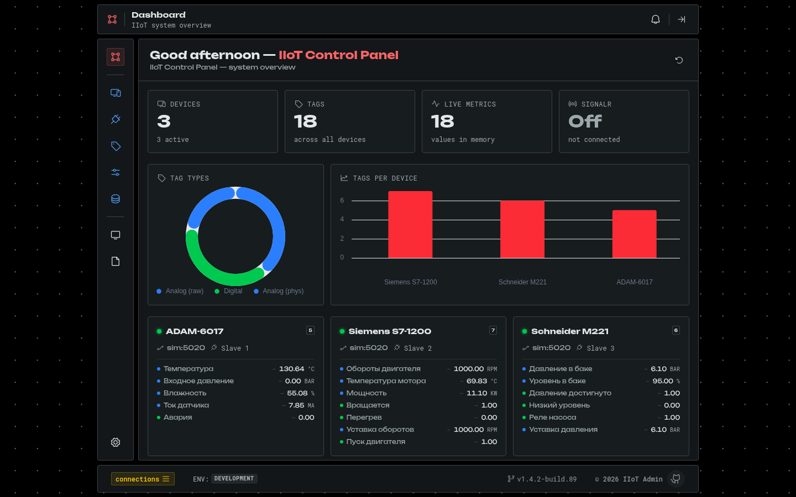
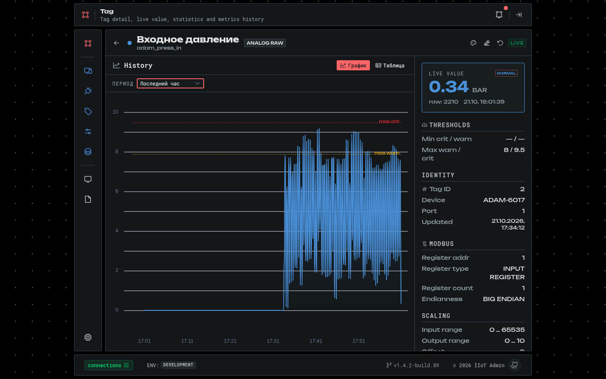
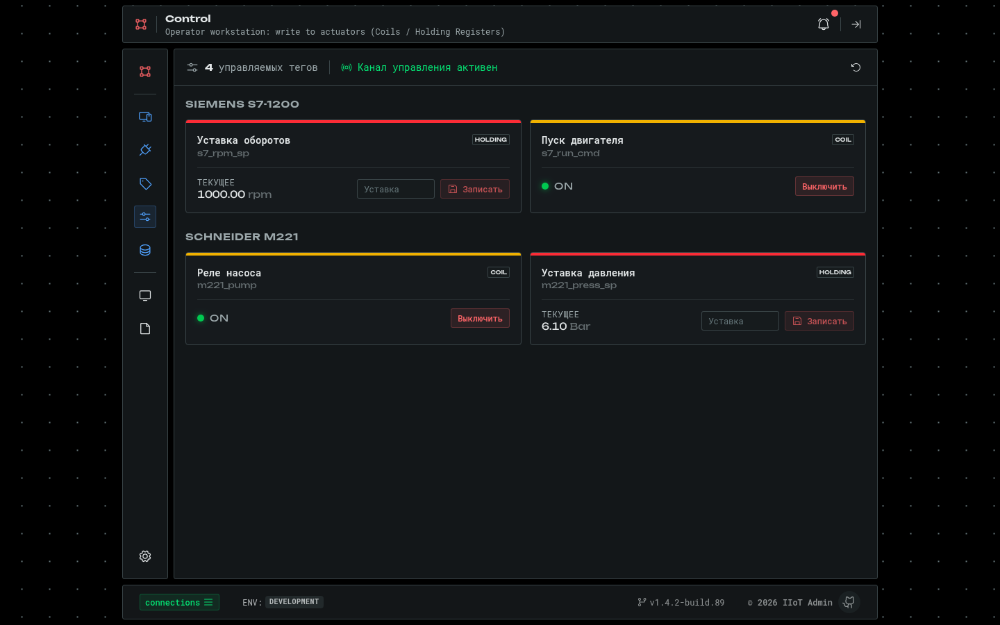
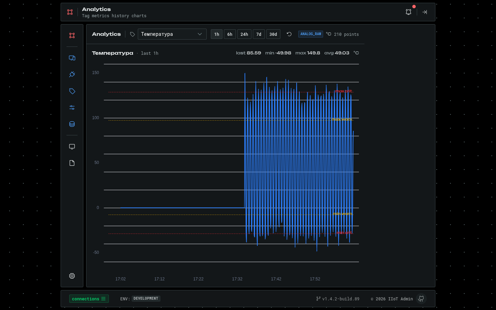
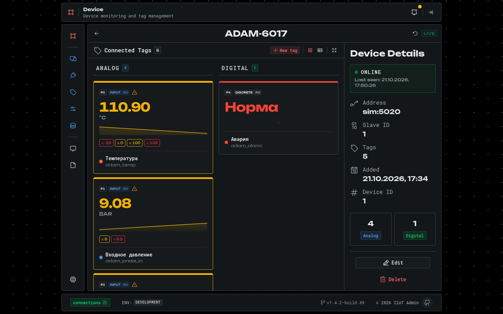

# IIoT Admin — HMI-панель мониторинга и управления

Веб-интерфейс промышленной IoT-системы: live-телеметрия с Modbus-устройств, история
метрик, пороговые алерты, управление устройствами и тегами и АРМ оператора для записи
команд в исполнительные механизмы (Coil / Holding Register).

Это фронтенд системы. Сбор данных, Web API и база данных — в репозитории
[iiot_core](https://github.com/Cirillio/iiot_core) (.NET 10, PostgreSQL + TimescaleDB).

**Стек:** Nuxt 4 · Vue 3.5 · TypeScript · Pinia · Nuxt UI 4 · Tailwind CSS 4 ·
nuxt-charts · SignalR · openapi-typescript · VueUse



| Тег: live-значение и история | АРМ управления |
| :---: | :---: |
|  |  |
| **Аналитика** | **Устройство и его теги** |
|  |  |

Все экраны с описанием — в [docs/SCREENSHOTS.md](docs/SCREENSHOTS.md).

---

## Возможности

- **Дашборд** — сводка по устройствам и тегам, распределение типов тегов, текущие значения по каждому устройству.
- **Устройства и подключения** — CRUD Modbus TCP-подключений и устройств (slave id, групповой опрос, онлайн-статус).
- **Теги** — CRUD тегов: адрес и тип регистра, тип данных, порядок байт, масштабирование, единицы. Редактор UI-конфигурации: цвет и пороги warning/critical.
- **Страница тега** — live-значение со статусом относительно порогов, график истории с линиями порогов, таблица сырых значений.
- **Аналитика** — история любого тега за 1 ч – 30 дней со статистикой (min / max / avg).
- **Сырые данные** — постраничная таблица всех метрик с фильтром по тегу и периоду.
- **Управление (АРМ оператора)** — переключение Coil и запись уставок в Holding Register; статус команды (в очереди → выполняется → успешно / ошибка) приходит в реальном времени.
- **Алерты** — уведомления при пересечении порогов и возврате в норму, центр уведомлений.
- **Настройки системы** — период опроса, deadband, heartbeat, хранение сырых и агрегированных данных; применяются в Collector без перезапуска.
- **Состояние системы** — здоровье сервисов Collector и Web API.
- **Логи приложения** — журнал событий клиента с фильтрами и экспортом в JSON.

---

## Архитектура

```
iiot_core: Collector ──► PostgreSQL/TimescaleDB ──pg_notify──► Web API
                                                    │
                       REST (/api/...) ◄────────────┤
                       SignalR /hubs/metrics ◄──────┤  live-метрики
                       SignalR /hubs/control ◄──────┘  статусы команд
                                  │
                              iiot_admin (SPA)
```

| Слой | Где | Что делает |
| :--- | :--- | :--- |
| Services | `app/services/` | Классы над `$fetch` по доменам API (Devices, Tags, Metrics, Control…), наследуют `BaseApiService`. Подключаются плагином и доступны через `useApi()`. |
| Types | `app/types/` | Типы API генерируются из OpenAPI-спецификации бэкенда (`openapi-typescript`), поверх — доменные модели. |
| Realtime | `composables/useSignalR.ts`, `useControlHub.ts` | Подключение к хабам SignalR, переподключение, маршрутизация событий в stores. |
| Stores | `app/stores/` | `realtime` — последние значения и кольцевой буфер трендов на тег; `alerts` — статусы тегов относительно порогов; `commands` — жизненный цикл команд записи; `notifications`, `app-logger`. |
| Utils | `app/utils/` | Оценка статуса значения по порогам, LTTB-даунсэмплинг длинных рядов для графиков без потери пиков. |

Приложение работает как SPA (`ssr: false`): данные живые и приходят по WebSocket, SEO не нужен.
При старте плагин подтягивает снимок последних значений, чтобы карточки не были пустыми до
первого live-опроса. Изменение конфигурации на бэкенде приходит событием `ConfigUpdated` и
обновляет данные без перезагрузки страницы.

---

## Запуск

### 1. Бэкенд

Админке нужен Web API из [iiot_core](https://github.com/Cirillio/iiot_core). Там же
Modbus-симулятор, так что реальное оборудование не нужно:

```bash
git clone https://github.com/Cirillio/iiot_core.git
cd iiot_core
docker compose up -d --build db sim client gateway   # API на http://localhost:8080
```

### 2. Админ-панель

```bash
bun install
bun dev          # http://localhost:3000
```

Адрес API задаётся переменной `NUXT_PUBLIC_API_BASE` (по умолчанию `http://localhost:8080`).
Live-подключение к SignalR включается переключателем в футере (статус `connections`) и
запоминается в браузере.

### Скрипты

| Команда | Назначение |
| :--- | :--- |
| `bun dev` | Dev-сервер. |
| `bun run build` / `bun run preview` | Production-сборка и её предпросмотр. |
| `bun run generate:types` | Перегенерировать `app/types/api-generated.d.ts` из `app/openapi.json`. |

---

## Структура

```
app/
├── pages/          # dashboard, devices, connections, tags, analytics, data, control, logs, settings, systems-status
├── components/     # по фичам: devices, tags, connections, control, charts, logs, settings, app (каркас)
├── composables/    # useApi, useSignalR, useControlHub, useWriteCommand, useLayout
├── services/       # клиенты REST API
├── stores/         # Pinia: realtime, alerts, commands, notifications, app-logger
├── plugins/        # api, signalr, alerts (снимок состояния при старте)
├── types/          # сгенерированные типы API и доменные модели
├── utils/          # статусы тегов, даунсэмплинг, форматирование enum'ов
└── openapi.json    # спецификация Web API
```
