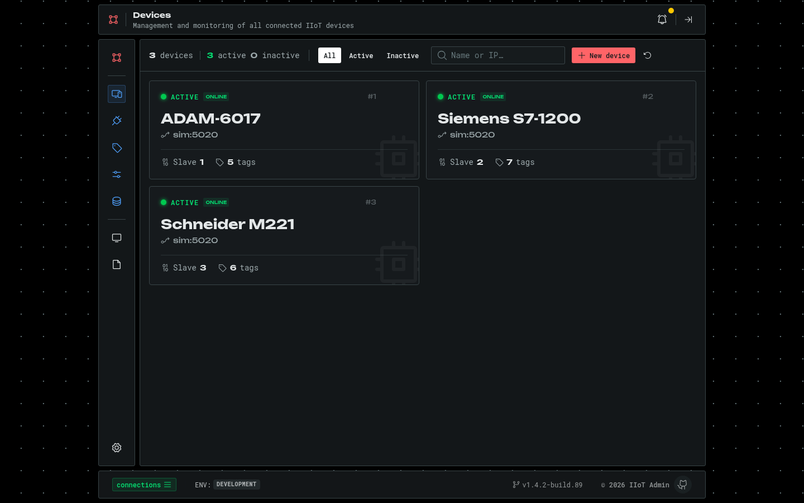
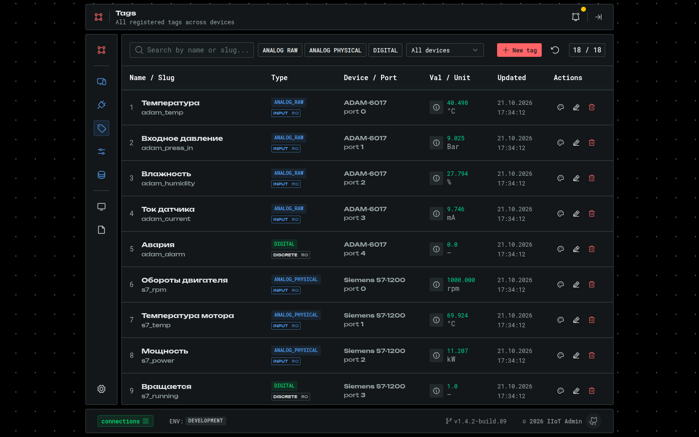
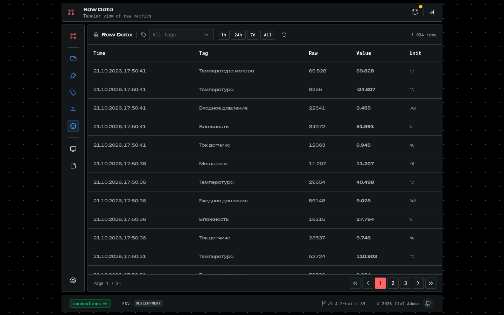
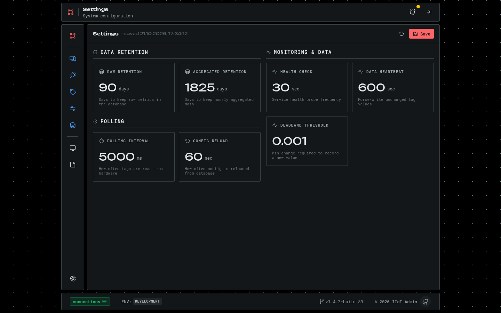
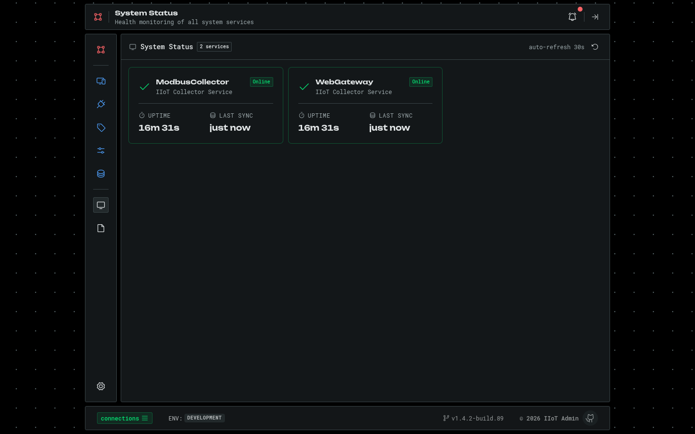
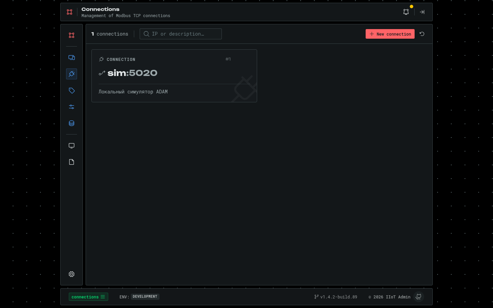

# Скриншоты

[← К README](../README.md)

Данные на скриншотах идут от Modbus-симулятора из [iiot_core](https://github.com/Cirillio/iiot_core):
три виртуальных устройства и 18 тегов.

**Дашборд** — сводка по устройствам и тегам, распределение типов, текущие значения.

**Устройства** — список с онлайн-статусом, поиском и фильтром.

**Устройство** — карточки тегов с live-значением, трендом и порогами, параметры устройства.

**Тег** — live-значение и статус относительно порогов, история с линиями порогов, параметры Modbus и масштабирования.

**Аналитика** — история тега за выбранный период и статистика.

**Теги** — реестр тегов всех устройств с фильтрами по типу и устройству.

**Управление** — АРМ оператора: запись уставок в Holding Register и переключение Coil.

**Сырые данные** — постраничная таблица метрик с фильтром по тегу и периоду.

**Настройки** — хранение данных, опрос, deadband; применяются без перезапуска Collector.

**Состояние системы** — здоровье сервисов Collector и Web API.

**Подключения** — Modbus TCP-подключения.

